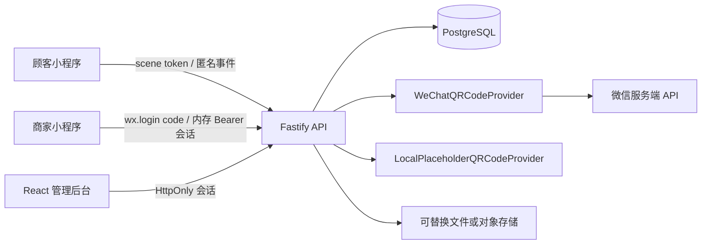
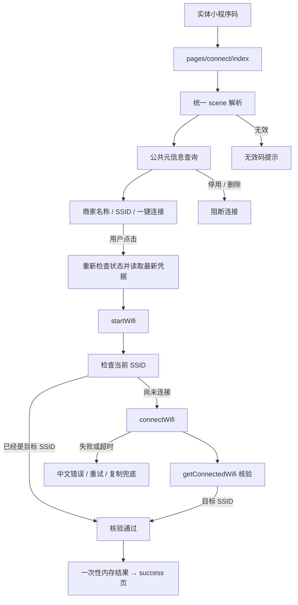
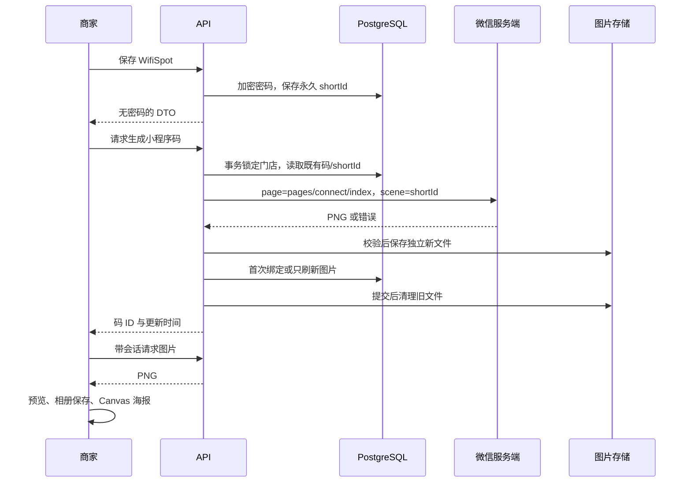

# 架构

## 模块职责



- `apps/api`：认证、授权、业务服务、持久化、审计、限流、OpenAPI 和微信服务端适配。
- `apps/admin-web`：平台管理员界面；不保存长期凭证，不获取 Wi-Fi 明文密码。
- `apps/mini-program`：原生商家创建/管理/制码/海报、scene 解析、公共配置读取、连接状态机、成功页、匿名事件和广告独立降级。
- `packages/validation`：服务端写入校验和跨端安全枚举。
- `packages/shared-types`：跨端 API 类型；凭据类型只由顾客主动操作时的接口使用，不用于管理员列表或页面状态。
- `packages/config`：启动时环境变量验证；服务器秘密不会被浏览器或小程序导入。

## 核心数据流

### 原生商家身份与生命周期

1. 商家调用 `wx.login`，将临时 code 交给 `POST /api/merchant/login`。后端用 AppID/AppSecret 调用微信 `jscode2session`；客户端不能指定 ownerId/OpenID。
2. 后端不保存原始 OpenID 和微信 session_key。使用固定域前缀 `wechat-merchant:v1:` 的 SHA-256 摘要将 OpenID 映射到 `merchants.openid_hash`。该单 AppID 部署的身份映射不依赖会话密钥，轮换 `SESSION_SECRET` 不会改变商家归属。
3. 后端生成随机商家 token，只在数据库保存 token 的 HMAC、商户 ID 和 12 小时到期时间；小程序只在进程内存持有 Bearer token。退出登录撤销会话；重启或过期重新登录。网页管理员继续使用原 Cookie 路径。
4. `WifiSpotService` 将已有门店、网络和码聚合为 WifiSpot。每次读取、编辑、删除、制码与图片下载都从会话检查所属商家；访问他人记录与不存在记录均返回安全的不存在响应。
5. 原生创建先保存一个所属门店与网络，同时生成永久 shortId，然后请求制码。制码失败保留网络，允许稍后重试；管理 DTO 不包含密码、OpenID 或数据库完整行。
6. 暂停/恢复修改网络状态；删除设置 `deleted_at`、停用相关码，并擦除当前网络行中的密码密文、IV、认证标签。最小关联记录保留，已打印贴纸不可继续取凭据；历史备份按既有保留策略管理。

数据库和文件存储继续使用现有后端；没有引入微信云开发、cloudfunctions 或第二套 Wi-Fi 集合。

### 管理员更新 Wi-Fi

1. 管理后台以 `credentials: include` 调用写接口。
2. API 校验 HttpOnly 会话、权限、限流和 Zod 请求体。
3. Wi-Fi 服务用环境主密钥和每次随机 96-bit IV 执行 AES-256-GCM。
4. 数据库只保存 ciphertext、IV 和 auth tag；更新配置版本。
5. 审计日志仅记录门店 ID、变更字段名和新版本，不记录密码或密文。

### 顾客扫码

1. `core/scene.ts` 统一选择页面的 scene/shortId/id、`getEnterOptionsSync().query` 与 `getLaunchOptionsSync().query`。显式页面值优先，错误值不能回退到陈旧码；解码后仅接受 32 字符小写十六进制。微信启动场景数字不是业务 shortId。
2. `POST /api/public/connect` 在严格 JSON 请求体中接收 `sceneToken`，联查启用的二维码、商户、门店和绑定 Wi-Fi。只返回门店/网络 ID、名称、SSID、可选 BSSID 与功能配置；不解密或返回密码。scene 不进入 URL。
3. 点击连接或复制密码时调用 `POST /api/public/credential`，再次检查全部启用状态并读取最新密码；响应 `Cache-Control: private, no-store`，限制请求频率。
4. `ConnectController` 将凭据直接交给连接适配器或剪贴板回调，密码不进入 `setData`、日志或小程序本地存储。页面区分加载、待连接、初始化、连接中、成功、失败、无效码和停用；失败时可重试或展开复制密码/SSID。自动连接必须通过 `getConnectedWifi` 读取到目标 SSID，不能只相信 success 回调或连接事件。
5. `AnalyticsService` 上报 PV、扫码、连接点击、成功/失败、复制密码及广告事件。客户端每日轮换随机访问 ID；后端只保存 UTC 日期与会话密钥计算的 HMAC，不保存原始标识。统计关闭或上报失败不阻塞主流程。



成功页只消费当前进程的一次性核验结果，直接打开该路由不能伪造成功。读取 SSID 表示系统报告连接到该网络，不表示互联网可达。开发/体验日志只输出固定阶段标签，省略密码、SSID、短码值和平台原始错误；release 关闭详细日志。

### 二维码生成

1. 创建网络时，API 生成 16 个密码学随机字节，编码为 32 个小写十六进制字符并持久化为 shortId。首次制码绑定该值，已有网络沿用已有 scene。
2. `WeChatQRCodeProvider` 获取缓存的 access token，服务端调用 getwxacodeunlimit，固定 `page=pages/connect/index`，scene 只包含 shortId。develop/trial 的 `check_path=false`，release 的 `check_path=true`；体验码不能用于面向所有顾客的正式贴纸。
3. 响应按 Content-Type/内容检测区分图片与微信 JSON 错误；外部错误脱敏。
4. 图片通过 `QRCodeStorage` 保存。门店行锁串行制码，新文件使用独立名称，事务提交后刷新图片位置再清理旧文件；失败保留原码和原图。修改密码、SSID 和重新生成图片都不改变 scene，也不自动解除停用。
5. 开发模式可显式使用本地占位 provider；生产模式选择本地占位会启动失败。



原生商家使用带认证请求头的 `downloadFile`，不把 token 放进 URL。Canvas 组合真实微信图片、标题和商家名称，输出 1200×1500 PNG，不重画核心二维码。占位图不作为原生正式预览/打印来源；输出尺寸不能代替实际打印可扫验收。码的 `qrFileId` 保留，`qrUpdatedAt` 表示最近刷新时间，无额外版本计数器。

## 数据设计

- 主键使用随机 UUID；时间使用 `timestamptz` 并保存 UTC。
- 所有外键列建索引。统计按门店/时间、事件类型/时间与失败错误/时间使用对应复合或部分索引。
- `scene_token` 唯一索引；启用资源使用状态/时间复合或部分索引。
- 管理列表使用有上限的分页；高增长事件和日志接口可演进为 `(created_at, id)` 游标分页。
- 状态和事件类型由数据库约束与 Zod 枚举双重保护。
- `merchants → stores → wifi_configs → qr_codes`：一商户多门店，一门店多网络，每个网络一个当前有效码。二维码和事件通过 `(store_id, wifi_id)` 复合外键防止串店；同网络生成/启用码通过门店行锁与部分唯一索引避免并发重复有效码。
- `0004_magenta_sue_storm.sql` 将历史门店归属默认商户、保留密码密文及 scene，并回填网络关联；历史无网络门店在添加首个网络时绑定旧码。旧 `/stores/:id/wifi` 接口保留，操作最早创建的默认网络；新功能使用 `/stores/:id/networks`。
- `0005_keen_sir_ram.sql` 新增 OpenID 摘要唯一映射、商家会话及到期/归属索引、永久 `short_id` 唯一索引、点位名称和软删除标记。已有网络优先继承启用码，否则取最新历史码的 scene；无历史码则保留新随机值。迁移不重新启用更早已废弃的历史码。
- `/api/admin/analytics` 按商户、门店、网络和 UTC 日期筛选/分组，结束时间不包含在范围内；成功率为成功事件数 / 点击连接事件数。UV 仅作每日匿名客户端去重，不能用作自然人人数或计费依据。

## 微信适配层

- `WeChatQRCodeProvider` 是后端正式小程序码实现，包含 access token 单飞缓存与到期前刷新。
- `LocalPlaceholderQRCodeProvider` 的输出必须出现“仅供本地测试”，不能冒充正式小程序码。
- `LegacyWeChatWifiAdapter` 只存在于小程序，集中封装 `startWifi/connectWifi/getConnectedWifi/onWifiConnected/offWifiConnected/stopWifi`，完成当前网络检查、二次核验和计时器/监听清理。诊断器是隔离的开发工具，不参与正式连接路径。

## 广告开关

```text
应加载广告 = ENABLE_ADS AND 全局开启 AND 门店开启 AND 广告位 ID 非空
```

- 条件为假时不实例化广告组件。
- 条件为真时异步实例化 `<ad>`；load/error 只影响广告容器和匿名广告事件。
- 无填充或失败时折叠父容器，不改变连接按钮或连接结果。
- 连接状态机不读取广告状态。
- `AdService` 为 banner、rewardedVideo、interstitial 保留类型边界，目前只实现可选 banner，默认全部关闭。
