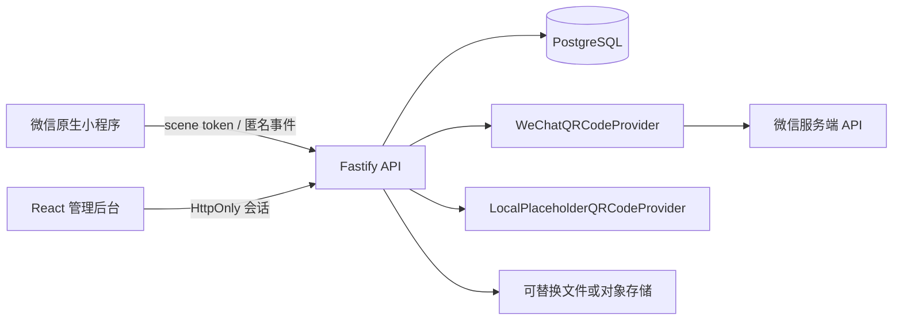

# 架构

当前后台复用同一 HttpOnly 会话登录，账号固定为管理员（`admin`）或同仁（`operator`）。管理员管理全部用户，同仁按 `stores.owner_id` 隔离列表、分页总数、Wi-Fi、二维码与统计。账号管理、全局设置、操作日志和用户转移只允许管理员；用户创建人独立保存，转移记录追加到现有操作日志。详见 [多人协作说明](TEAM_USAGE.md)。

## 模块职责



- `apps/api`：认证、授权、业务服务、持久化、审计、限流、OpenAPI 和微信服务端适配。
- `apps/admin-web`：平台管理员界面；不保存长期凭证，不获取 Wi-Fi 明文密码。
- `apps/mini-program`：scene 解析、公共配置读取、连接状态机、匿名事件、广告独立降级。
- `packages/validation`：服务端写入校验和跨端安全枚举。
- `packages/shared-types`：跨端 API 类型定义；只有按需凭据响应类型包含 Wi-Fi 密码字段，不包含任何服务端密钥。
- `packages/config`：启动时环境变量验证；服务器秘密不会被浏览器或小程序导入。

## 核心数据流

### 管理员更新 Wi-Fi

1. 管理后台以 `credentials: include` 调用写接口。
2. API 校验 HttpOnly 会话、权限、限流和 Zod 请求体。
3. Wi-Fi 服务用环境主密钥和每次随机 96-bit IV 执行 AES-256-GCM。
4. 数据库只保存 ciphertext、IV 和 auth tag；更新配置版本。
5. 审计日志仅记录用户 ID、变更字段名和新版本，不记录密码或密文。

### 顾客扫码

1. 小程序从 `Page.onLoad(query)` 获取 `scene`，解码并验证 32 字符十六进制格式。
2. `GET /api/public/connect/:sceneToken` 联查启用的二维码、用户和 Wi-Fi 配置。
3. 页面配置仅返回用户、SSID、广告和兼容状态，不解密或返回密码。
4. 用户点击连接后，`POST /api/public/credential` 携带 `{ sceneToken }`，重新验证启用状态及兼容开关，再瞬时解密凭据；独立限流且响应 `private, no-store`。小程序只在当次连接中使用凭据，重试重新获取，卸载丢弃回包。
5. page view、点击、成功/失败和广告加载事件按白名单匿名上报。

### 二维码生成

1. API 生成 16 个密码学随机字节，编码为 32 个小写十六进制字符。
2. `WeChatQRCodeProvider` 获取缓存的 access token，服务端调用不限制小程序码接口。
3. 响应按 Content-Type/内容检测区分图片与微信 JSON 错误；外部错误脱敏。
4. 图片通过 `QRCodeStorage` 保存。修改 Wi-Fi 不修改 scene token。
5. 开发模式可显式使用本地占位 provider；生产模式选择本地占位会启动失败。
6. 同一用户生成、启用和停用二维码先锁定用户行，串行更新，保持最多一个启用码；列表及详情优先显示启用码。

## 数据设计

- 主键使用随机 UUID；时间使用 `timestamptz` 并保存 UTC。
- 所有外键列建索引。统计按用户/时间、事件类型/时间与失败错误/时间使用对应复合或部分索引。
- `scene_token` 唯一索引；启用资源使用状态/时间复合或部分索引。
- 管理列表使用有上限的分页；高增长事件和日志接口可演进为 `(created_at, id)` 游标分页。
- 状态和事件类型由数据库约束与 Zod 枚举双重保护。

## 微信适配层

- `WeChatQRCodeProvider` 是后端正式小程序码实现，包含 access token 单飞缓存与到期前刷新。
- `LocalPlaceholderQRCodeProvider` 的输出必须出现“仅供本地测试”，不能冒充正式小程序码。
- `WeChatWifiAdapter` 只存在于小程序，封装旧 `startWifi/connectWifi/onWifiConnected/offWifiConnected/stopWifi` 契约。
- 官方总览当前声明 Wi-Fi 系列已下架，且不能用 `wx.canIUse` 判断。因此生产默认禁用；适配器的函数存在性检查只用于防御，不能推翻官方状态。

## 广告开关

```text
应加载广告 = 全局开启 AND 用户开启 AND 广告位 ID 非空
```

- 条件为假时不实例化广告组件。
- 条件为真时异步实例化 `<ad>`；load/error 只影响广告容器和匿名广告事件。
- 无填充或失败时折叠父容器，不改变连接按钮或连接结果。
- 连接状态机不读取广告状态。
